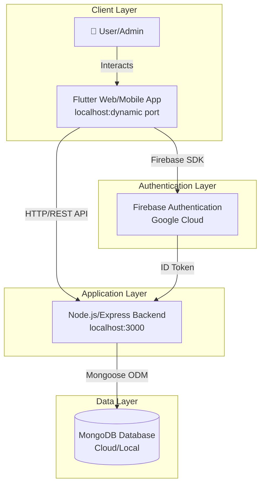
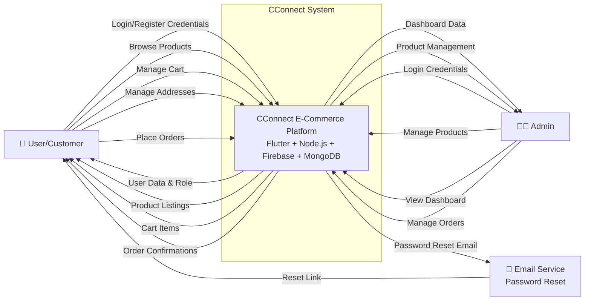
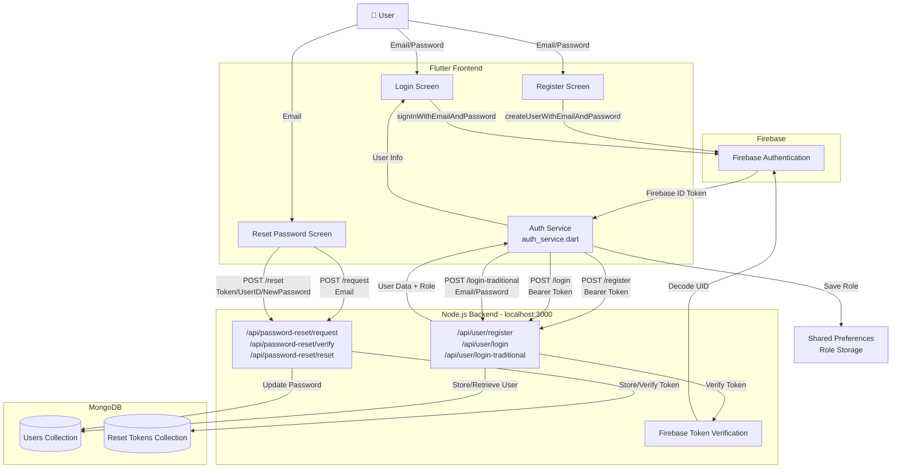
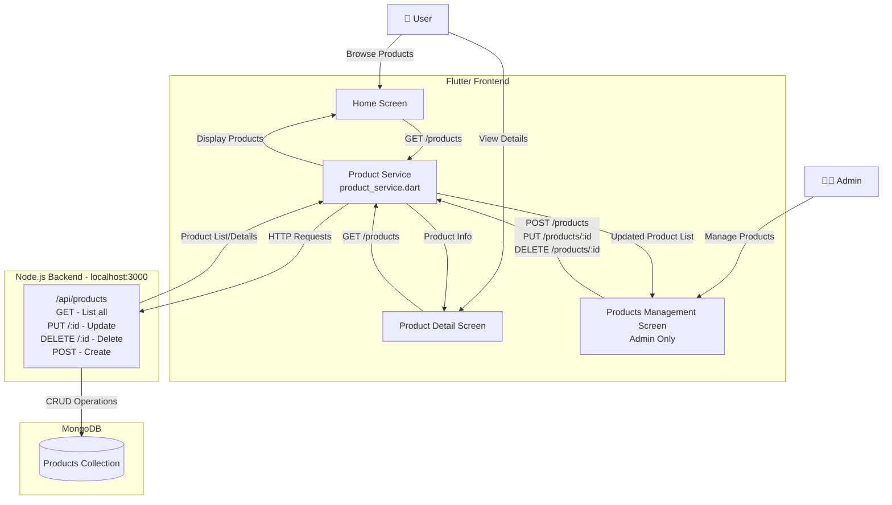
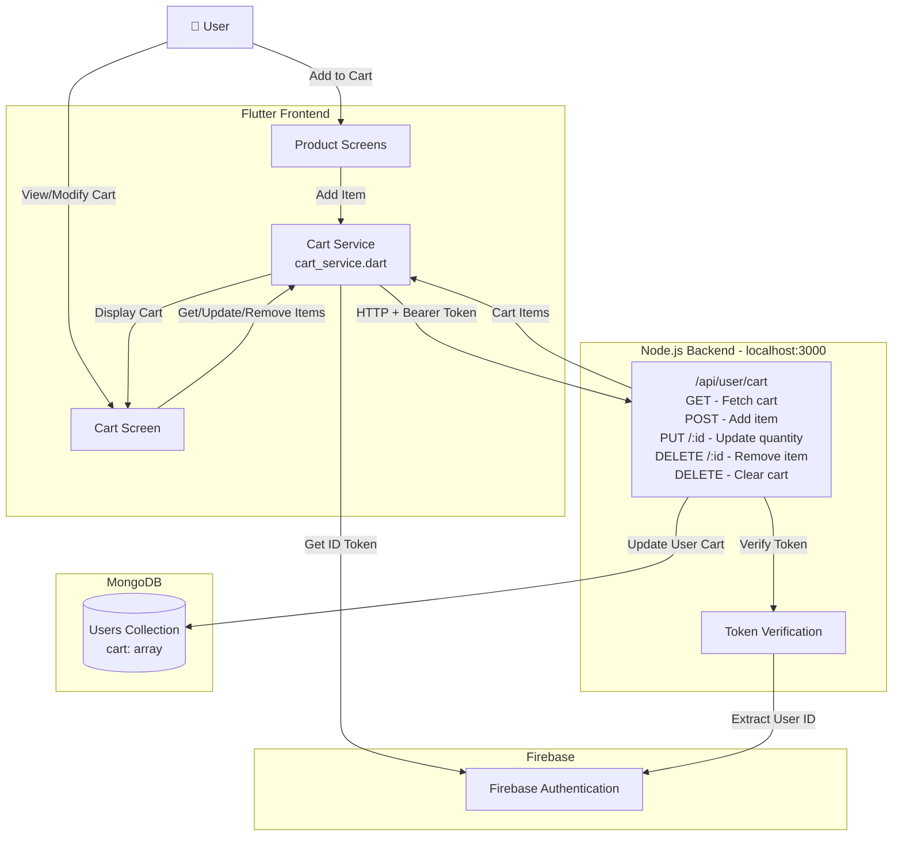
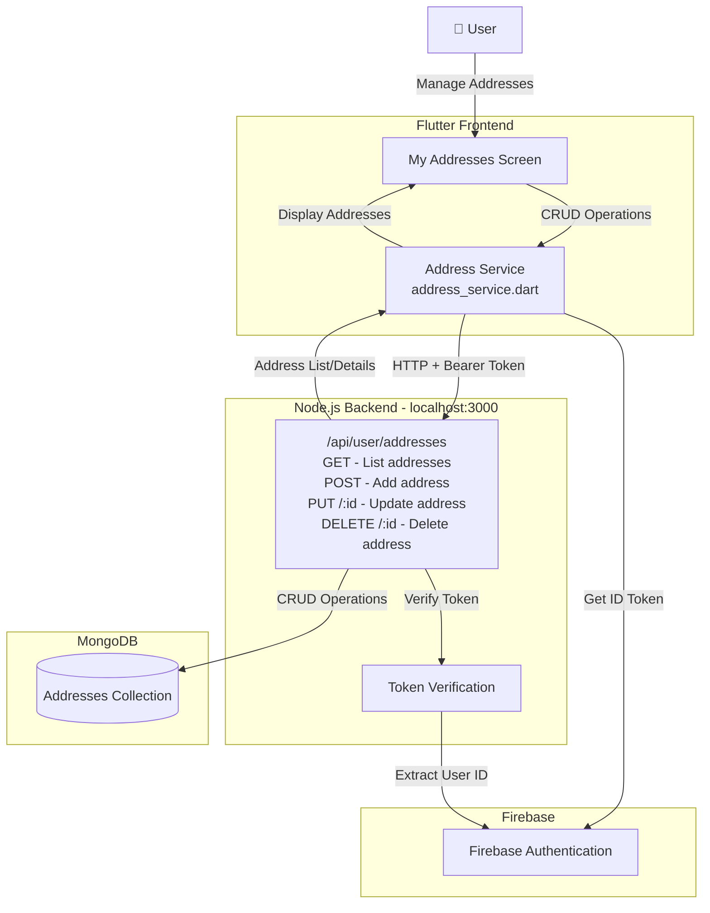

# Physical Data Flow Diagram (DFD) - CConnect Application

## Overview
This document presents the Physical Data Flow Diagram for the CConnect e-commerce application, showing the actual implementation of data flows between physical components including the Flutter frontend, Node.js backend, Firebase authentication, and MongoDB database.

---

## System Architecture Diagram



---

## Detailed Physical DFD - Level 0 (Context Diagram)



---

## Physical DFD - Level 1 (Authentication & User Management)



---

## Physical DFD - Level 1 (Product Management)



---

## Physical DFD - Level 1 (Cart Management)



---

## Physical DFD - Level 1 (Address Management)



---

## Data Flow Details

### Authentication Flow

#### Firebase Registration Flow
1. User enters email/password in `RegisterScreen`
2. Flutter calls `FirebaseAuth.createUserWithEmailAndPassword()`
3. Firebase creates user account and returns `UserCredential`
4. Flutter extracts Firebase ID Token
5. `AuthService.registerWithEmail()` sends POST to `/api/user/register` with Bearer token
6. Backend verifies token with Firebase Admin SDK
7. Backend creates user record in MongoDB with role ('admin' for adminacc@gmail.com, 'user' otherwise)
8. Backend returns user data with role
9. Flutter saves role to SharedPreferences
10. User is redirected based on role

#### Firebase Login Flow
1. User enters credentials in `LoginScreen`
2. Flutter calls `FirebaseAuth.signInWithEmailAndPassword()`
3. Firebase authenticates and returns `UserCredential`
4. Flutter extracts Firebase ID Token
5. `AuthService.loginWithEmail()` sends POST to `/api/user/login` with Bearer token
6. Backend verifies token and retrieves user from MongoDB
7. Backend returns user data with role
8. If Firebase login fails, fallback to traditional login
9. Flutter saves role and redirects user

#### Traditional Login Flow (Password Reset Users)
1. User enters credentials in `LoginScreen`
2. `AuthService.loginWithTraditional()` sends POST to `/api/user/login-traditional`
3. Backend validates email/password against MongoDB (bcrypt)
4. Backend returns user data with role
5. Flutter saves role and redirects user

#### Password Reset Flow
1. User enters email in `ForgotPasswordScreen`
2. `AuthService.requestPasswordReset()` sends POST to `/api/password-reset/request`
3. Backend generates reset token and stores in MongoDB
4. Backend sends email with reset link containing token and userId
5. User clicks link and opens `ResetPasswordScreen`
6. User enters new password
7. `AuthService.resetPassword()` sends POST to `/api/password-reset/reset`
8. Backend verifies token and updates password in MongoDB
9. User can now login with traditional method

---

### Product Management Flow

#### Fetch Products
1. User opens `HomeScreen` or `ProductDetailScreen`
2. `ProductService.getProducts()` sends GET to `/api/products`
3. Backend queries MongoDB Products collection
4. Backend returns product array
5. Flutter displays products in UI

#### Admin Product CRUD
1. Admin opens `ProductsManagementScreen`
2. Admin creates/updates/deletes product
3. `ProductService` sends POST/PUT/DELETE to `/api/products/:id`
4. Backend performs operation on MongoDB
5. Backend returns updated product or success status
6. Flutter refreshes product list

---

### Cart Management Flow

1. User adds product to cart from product screen
2. `CartService.addItem()` gets Firebase ID token
3. Sends POST to `/api/user/cart` with Bearer token and item data
4. Backend verifies token and extracts user ID
5. Backend updates user's cart array in MongoDB
6. Backend returns success status
7. Similar flow for get/update/remove/clear operations

---

### Address Management Flow

1. User opens `MyAddressesScreen`
2. `AddressService.getAddresses()` gets Firebase ID token
3. Sends GET to `/api/user/addresses` with Bearer token
4. Backend verifies token and queries addresses for user
5. Backend returns address array from MongoDB
6. Flutter displays addresses
7. CRUD operations follow similar authenticated flow

---

## Technology Stack

### Frontend (Flutter)
- **Platform**: Web (localhost:dynamic), Android (10.0.2.2:3000), iOS
- **State Management**: StatefulWidget
- **HTTP Client**: `http` package
- **Local Storage**: `shared_preferences` (role storage)
- **Authentication**: `firebase_auth` package

### Backend (Node.js)
- **Server**: Express.js on localhost:3000
- **Authentication**: Firebase Admin SDK
- **Database ODM**: Mongoose
- **Password Hashing**: bcrypt
- **CORS**: Enabled for Flutter origins

### Database (MongoDB)
- **Collections**:
  - `users` - User accounts with cart array and role
  - `products` - Product catalog
  - `addresses` - User delivery addresses
  - `reset_tokens` - Password reset tokens
  - `orders` - Order history

### External Services
- **Firebase Authentication**: Google Cloud
- **Email Service**: Password reset notifications

---

## Network Communication

### API Endpoints

#### Authentication
- `POST /api/user/register` - Firebase-based registration
- `POST /api/user/login` - Firebase-based login
- `POST /api/user/login-traditional` - MongoDB-based login
- `POST /api/password-reset/request` - Request reset link
- `GET /api/password-reset/verify` - Verify reset token
- `POST /api/password-reset/reset` - Reset password

#### Products
- `GET /api/products` - List all products
- `POST /api/products` - Create product (admin)
- `PUT /api/products/:id` - Update product (admin)
- `DELETE /api/products/:id` - Delete product (admin)

#### Cart (Authenticated)
- `GET /api/user/cart` - Fetch cart items
- `POST /api/user/cart` - Add item to cart
- `PUT /api/user/cart/:productId` - Update quantity
- `DELETE /api/user/cart/:productId` - Remove item
- `DELETE /api/user/cart` - Clear cart

#### Addresses (Authenticated)
- `GET /api/user/addresses` - List addresses
- `POST /api/user/addresses` - Add address
- `PUT /api/user/addresses/:id` - Update address
- `DELETE /api/user/addresses/:id` - Delete address

### Authentication Headers
```
Authorization: Bearer <Firebase_ID_Token>
Content-Type: application/json
```

---

## Data Stores

### SharedPreferences (Flutter Local Storage)
```
Key: 'user_role'
Value: 'admin' | 'user'
```

### MongoDB Collections Schema

#### Users Collection
```json
{
  "_id": "ObjectId",
  "firebaseUid": "string",
  "email": "string",
  "password": "string (hashed)",
  "role": "admin | user",
  "cart": [
    {
      "productId": "string",
      "quantity": "number",
      "name": "string",
      "price": "number"
    }
  ],
  "createdAt": "Date",
  "updatedAt": "Date"
}
```

#### Products Collection
```json
{
  "_id": "ObjectId",
  "name": "string",
  "description": "string",
  "price": "number",
  "imageUrl": "string",
  "stock": "number",
  "category": "string"
}
```

#### Addresses Collection
```json
{
  "_id": "ObjectId",
  "userId": "string (firebaseUid)",
  "label": "string",
  "street": "string",
  "city": "string",
  "state": "string",
  "zipCode": "string",
  "country": "string",
  "isDefault": "boolean"
}
```

#### Reset Tokens Collection
```json
{
  "_id": "ObjectId",
  "userId": "string",
  "token": "string",
  "expiresAt": "Date",
  "used": "boolean"
}
```

---

## Security Considerations

1. **Firebase ID Token Verification**: All authenticated endpoints verify Firebase tokens server-side
2. **Role-Based Access Control**: Admin endpoints check user role from MongoDB
3. **Password Hashing**: bcrypt for traditional login passwords
4. **Token Expiration**: Reset tokens expire after set duration
5. **CORS Configuration**: Backend restricts origins
6. **HTTPS**: Should be used in production (currently localhost)

---

## Deployment Architecture

### Development
- **Frontend**: `localhost:<dynamic_port>` (Flutter web dev server)
- **Backend**: `localhost:3000` (Node.js Express)
- **Database**: MongoDB local or cloud (MongoDB Atlas)
- **Firebase**: Google Cloud

### Production (Recommended)
- **Frontend**: Deployed to Firebase Hosting / Vercel / Netlify
- **Backend**: Deployed to Render / Heroku / AWS
- **Database**: MongoDB Atlas (cloud)
- **Firebase**: Google Cloud (production project)

---

## Notes

- The system uses dual authentication: Firebase for new users, MongoDB for password-reset users
- Admin role is determined by email (`adminacc@gmail.com`)
- Cart data is stored in user document (embedded array)
- All authenticated requests require Firebase ID token in Authorization header
- Platform-specific backend URLs (web: localhost, Android: 10.0.2.2)
